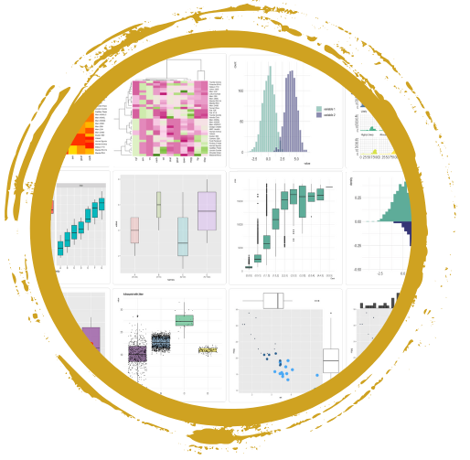
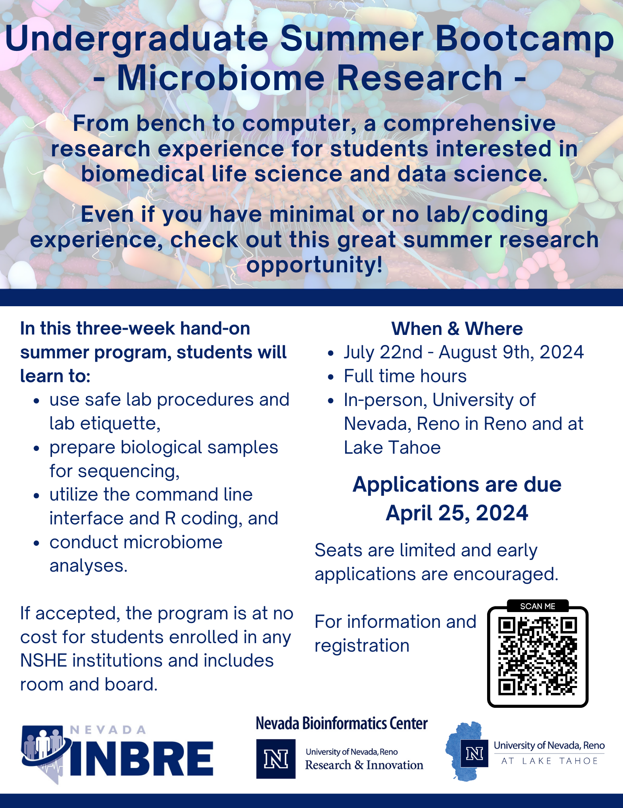

 

**The Biomarker Hunt: A Research Data Challenge** 
*Think like a data scientist. Work like a research team.* 
 
**January 12 - January 16, 2027** 
**University of Nevada, Reno at Lake Tahoe **

  

**The Biomarker Hunt** is a collaborative research data challenge combining short instructional sessions with hands-on investigation. Working in small teams, participants will explore authentic proteomics (DIA) and transcriptomics (RNA-seq) datasets to investigate biomedical questions and develop practical data science skills.

**Think like a researcher, not just a tutorial follower.** Teams will ask questions, evaluate data quality, choose analytical approaches, and find creative ways to visualize and communicate their results. The challenge emphasizes critical thinking, reproducibility, teamwork, and scientific communication—skills that transfer well beyond biomedical research.

**What You Will Experience**

 - Strengthen R programming skills through applied data analysis
 - Explore and assess the quality of proteomics and transcriptomics datasets
 - Investigate differentially abundant proteins and expressed genes
 - Explore biological pathways and potential molecular biomarkers
 - Develop and evaluate hypotheses using multi-omics data
 - Experiment with effective and creative data visualizations
 - Collaborate in a small research team and communicate your discoveries

**Like real research, there is no single right answer.** Teams will follow their own questions and may progress at different rates. At the end of the challenge, each team will share its discoveries in a **3-minute flash talk**. Awards will recognize creativity, innovation, data visualization, scientific communication, and analytical thinking.

 

<!-- ## Blast from the Past -->

<!-- <a href="https://www.unr.edu/nevada-today/news/2023/microbiome-research-program">Check out the Nevada Today Article about our program.</a> -->

<!--  -->

### Program Details

The program runs from **Tuesday, January 12, 2027, at 1:30 PM through Saturday, January 16, 2027, at 3:30 PM**.

*This is a full-time, residential training event. Participants are expected to stay on-site for the entire program at the University of Nevada, Reno at Lake Tahoe campus in Incline Village.*

The Biomarker Hunt simulates the early stages of a data-intensive research project. Short instructional sessions introduce key concepts and analytical tools, while most of the program is dedicated to hands-on, team-based investigation.

Teams will explore proteomics and transcriptomics data, evaluate data quality, investigate biological questions, and identify potential biomarkers. Each team will determine its own analytical approach and present its findings in a final flash talk. **Completing every possible analysis is not required.** The emphasis is on curiosity, critical thinking, collaboration, and learning through exploration.

 

### Program Costs and Travel Support

**All program fees include training, shared accommodations, and meals.**

 - **Nevada System of Higher Education (NSHE) students — FREE!** Thanks to funding from the NIH-supported Nevada INBRE program, participation is free for NSHE students
 - **Students from other INBRE states — $300.** We welcome students from other states participating in the NIH IDeA program! Please contact us, and we will be happy to explore potential financial support through your home state's INBRE program
 - **Students from non-INBRE states — $500.** Students from states without an INBRE program are also welcome to participate!

**Transportation is not included.** Participants are responsible for arranging travel to and from the Lake Tahoe campus in Incline Village, **not UNR's main campus in Reno**. For those flying, the nearest major airport is Reno-Tahoe International Airport (RNO). Incline Village is approximately a 45-minute drive from Reno under favorable conditions; winter weather can substantially affect travel times and road conditions.

Participants may arrange a shuttle, rideshare, or carpool. We are happy to share transportation information and, with participants' permission, connect accepted students interested in carpooling from Reno or Carson City. **Carpooling and other transportation options are not guaranteed.** To inquire about potential travel funding, please contact your local INBRE representative (site coordinator).

 

### Eligibility & Recommended Background

The program is intended for students interested in biomedical data science who have completed at least one year of college. Graduate students are welcome to apply, but **priority will be given to undergraduate students**.

Participants should have:

 - Basic R programming experience, including importing data, working with data frames, and making simple plots
 - An introductory understanding of statistics
 - An interest in working with data and solving open-ended problems

**Previous experience with bioinformatics, transcriptomics, or proteomics is not required.** This is not an introductory R workshop, but preparation resources will be shared before the program. If you are interested and have not yet learned R, please reach out. NV INBRE Data Science Core North and South are planning an *R Introductory Plus* workshop the week before the challenge.

**Laptop requirements:** Participants need a laptop with **R and RStudio installed**, as well as sufficient internal storage to work with the training datasets. Tablets, including tablet-style Surface devices, are not sufficient. If you do not have a suitable laptop, indicate this in your application; **we can provide a loaner for the training event**. Additional setup instructions will be shared before the program.

 

### How to Apply

Complete the online application by **December 27, 2026**. Applications will be reviewed on a rolling basis **every Friday beginning December 4**, with acceptance or waitlist notifications sent the following Monday. **Early applications are encouraged**, as space is limited.

**Application materials**

 - A brief personal statement describing why you would like to participate and what you hope to gain
 - An unofficial transcript
 - One academic or professional reference who can speak to your academic performance and personal qualities; the reference may be contacted during review

**Participation commitment:** Once you accept your place, we reserve housing, meals, and training resources for you. If your plans change, please notify us as early as possible so we can offer your place to another student and avoid unnecessary expenses. We appreciate your consideration for fellow applicants!

<a href="https://nvideaoffice.formstack.com/forms/biomarkerhunt">**Apply Now!**</a>

 

### Event Logistics

The program will be held at the **University of Nevada, Reno at Lake Tahoe campus in Incline Village, Nevada**.

 

**Tentative Program Schedule**

<table class="tg">
<thead>
  <tr><th>Day</th><th>Program Focus</th><th>Start Time</th></tr>
</thead>
<tbody>
  <tr>
      <td>Tuesday, Jan 12</td>
      <td><strong>Welcome &amp; Foundations:</strong> Introductions, R refresher, and biological concepts</td>
      <td>1:30 PM — Welcome and check-in</td>
  </tr>
  <tr>
      <td>Wednesday, Jan 13</td>
      <td><strong>Explore &amp; Analyze:</strong> Study design, data exploration, visualization, and introduction to proteomics</td>
      <td>8:45 AM — Activities begin</td>
  </tr>
  <tr><td>Thursday, Jan 14</td><td><strong>Analyze &amp; Investigate:</strong> Transcriptomics, differential analysis, and team investigations</td><td>8:30 AM — Activities begin</td></tr>
  <tr><td>Friday, Jan 15</td><td><strong>Integrate &amp; Discover:</strong> Multi-omics exploration, biomarker discovery, and hypothesis development</td><td>8:45 AM — Activities begin</td></tr>
  <tr><td>Saturday, Jan 16</td><td><strong>Communicate &amp; Reflect:</strong> Final analyses, 3-minute flash talks, and closing discussion</td><td>8:30 AM — Activities begin; program ends at 3:30 PM</td></tr>
</tbody>
</table>

*The schedule combines short instructional sessions with extensive hands-on, team-based investigation. Activities may be adjusted to support participants' progress and discoveries.*

**Accommodations:** Shared dormitory rooms (triple, same-sex occupancy) will be provided for all participants. Bedding, linens, and towels are included. Additional housing details will be shared after acceptance.

**Meals:** Meals are included throughout the program, with a variety of options and labeled food selections. Please provide any dietary restrictions in your registration information. We plan to share the initial dietary requirements with the campus kitchen on December 17; please communicate your needs as early as possible. We will do our best to accommodate later requests, but cannot guarantee them.

**Before arrival:** Accepted participants will receive additional information about laptop setup, campus arrival, accommodations, and transportation options.

### Questions

Reach out at any time, email nbc_training@unr.edu or call (775) 784-4359.

<!-- ### Flier -->

<!-- 

 -->

### Presenters
Nevada Bioinformatics Center / Nevada INBRE Data Science Core

 - Juli Petereit, PhD 
 - Cassandra Hui, PhD
 - Hans Vasquez-Gross, PhD

### Acknowledgments
This bootcamp is made possible by grants from the National Institute of General Medical Sciences (GM103440) from the National Institutes of Health and the National Science Foundation (2203236).

<!--  -->

 

